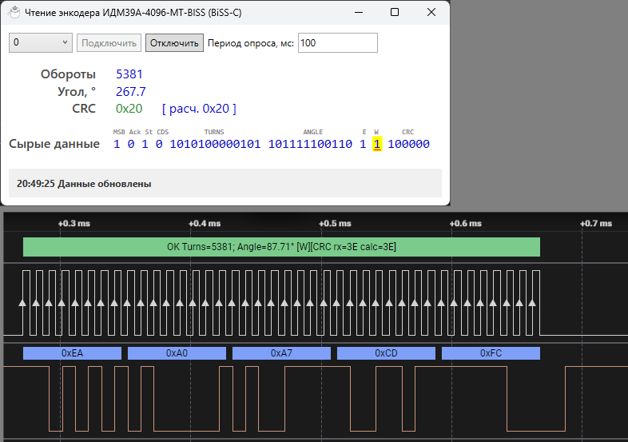

Разборщик пакетов многооборотного энкодера **ИДМ39А-4096-MT-BISS** для программы **Saleae Logic 2** с использованием линий CLK и DATA интерфейса SPI.

### Пример
На скриншоте ниже - разбор с помощью программы и приложенным парсером протокола BISS.

## Установка
- Скопируйте оба файла -- *extension.json* и *HighLevelAnalyzer.py* в одну директорию.
- В программе **Saleae Logic** в разделе *Extensions* в меню - *Load Existing Extension* и выберите директорию с файлами парсера.

## Использование
- Добавьте анализатор SPI.
- Добавьте анализатор BISS-C (IDM39A).
- Укажите в качестве источника данных анализатор SPI.
